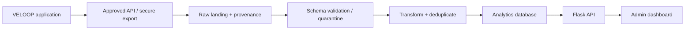

# Proposed analytics architecture

Current demo uses labelled synthetic CSVs and SQLite. Production use requires approved source access, secure ingestion, managed database, authentication, audit logging, monitoring and stakeholder sign-off.
